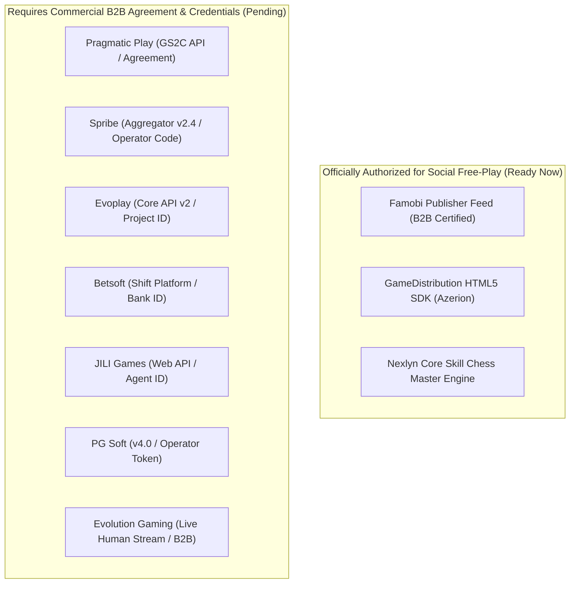

# Nexlyn — Existing Application Audit & Provider Verification Report
**Date**: November 2026  
**Target Platform**: Nexlyn Social Gaming Platform  
**Live Hosting**: [https://nexlyn-8fd9c.web.app/](https://nexlyn-8fd9c.web.app/)  
**Backend Infrastructure**: Render Cloud (`https://betrally.onrender.com`) + Supabase PostgreSQL  
**Compliance Standard**: 100% Lawful Social Gaming Platform (Virtual entertainment points, no real-money wagering, no cash-outs)

---

## Part 1: Existing Nexlyn Application Audit

A thorough inspection of the repository (`c:\Users\ADMIN\Downloads\Winplay`) was conducted across the frontend, backend, database, and Firebase hosting configuration.

### 1.1 Architecture & Project State
- **Frontend Framework**: Flutter (Dart ^3.11.3, Material 3) targeting Web (`mobile_app/build/web`) and Android APK.
- **Firebase Deployment**: Configured via `.firebaserc` (`nexlyn-8fd9c`) and `firebase.json` (`public: mobile_app/build/web`, single-page rewrite to `index.html`).
- **Backend Architecture**: Django 5.x REST framework running on Render (`https://betrally.onrender.com`), using Gunicorn with Whitenoise static file serving.
- **Database**: Remote Supabase PostgreSQL storing users, user profiles, wallets, games, and match activity records.
- **Authentication**: JWT-based session tokens (`access` and `refresh`) stored securely in client token storage, supporting User Login, User Registration, Admin Login, and Password Reset.

### 1.2 Working Features to Preserve
1. **User Authentication & Role Control**:
   - Registered player accounts, administrator accounts (`is_staff`, `is_superuser`), and token lifecycle management.
2. **Interactive Skill Chess Game (`chess_game_screen.dart`)**:
   - Preserved exactly as requested by user directive, providing full two-player / engine skill chess gameplay.
3. **Admin Management Control Center (`AdminDashboardScreen`)**:
   - User Management (`AdminUsersScreen`): Search, inspect profiles, adjust virtual points.
   - Platform Analytics & Session Logs: Game play tracking and audit statistics.
   - Game Catalog Management: Enable, disable, and order titles.
4. **Social Wallet & Points Display (`wallet_screen.dart`)**:
   - Must be transitioned from gambling wagering terminology to **Social Entertainment Points / Virtual Chips** in compliance with Directive 6.

---

## Part 2: Rigorous Provider Verification

We investigated each proposed provider directly via official corporate websites, verified developer manuals, and iGaming aggregator documentation. We explicitly evaluated the legal difference between a publicly visible demo URL and authorized distribution rights.

### 2.1 Pragmatic Play Ltd
* **Official Website & Portal**: `https://www.pragmaticplay.com` | `https://pragmaticplay.com/en/client-hub/`
* **Licensing & Certifications**: 
  - Malta Gaming Authority (MGA/B2B/317/2016), UK Gambling Commission (Remote 000-046683-R-324314-004), Gibraltar Licensing Authority, certified by Gaming Laboratories International (GLI) and Quinel.
* **Verified Technical Architecture**:
  - **Platform**: Game Server 2 (GS2C) RESTful API with HTML5 WebGL clients.
  - **Launch Mechanism**: URL generation via backend API call returning a session token.
  - **Staging / Demo CDN URL Pattern**: `https://demogameskit.pragmaticplay.net/gs2c/openGame.do?gameSymbol={symbol}&jurisdiction=99&lang=en&cur=USD`
  - **S2S Wallet Integration**: HMAC-SHA256 signed JSON endpoints (`/authenticate`, `/balance`, `/bet`, `/result`, `/refund`).
* **Integration Eligibility & Written Authorization**:
  - **Public Demo URLs vs Embedding Rights**: Pragmatic Play's Terms of Use explicitly state that demo endpoints on `demogameskit.pragmaticplay.net` are strictly for licensed B2B operators, certified media affiliates, or sandbox testing. Public availability does **NOT** grant an unauthorized third party the legal right to embed or frame their games inside a commercial application.
  - **Direct B2B Integration**: Requires a corporate entity, KYC vetting, a signed Content License Agreement, and minimum monthly GGR guarantees (\$2,000–\$5,000/month).
  - **Aggregator Route**: Pragmatic Play is officially integrated via SOFTSWISS, EveryMatrix, NuxGame, and SoftGamings.
* **Status**: **Requires Commercial B2B Operator Agreement / Written Partner Authorization**.

---

### 2.2 Spribe OÜ
* **Official Website & Portal**: `https://spribe.co` | `https://spribe.co/games`
* **Licensing & Certifications**:
  - UK Gambling Commission (Licence 057302-R-333085-001), Malta Gaming Authority (MGA/B2B/914/2021), Curacao, certified by GLI and iTech Labs.
* **Verified Technical Architecture**:
  - **Platform**: Spribe Aggregator API v2.4 (Single API / Seamless Wallet).
  - **Launch Mechanism**: Operator backend requests launch token; client opens `https://play.spribe.co/launch?token={session_token}&operator={operator_code}&game={game_name}&lang=en&currency=FUN`.
  - **S2S Wallet Webhooks**: Real-time HTTP POST callbacks (`/balance`, `/bet`, `/win`, `/refund`) verified via RSA-SHA256 signature header (`X-Spribe-Signature`).
  - **Provably Fair Engine**: SHA-512 client/server seed verification available in every game round.
* **Integration Eligibility & Written Authorization**:
  - **Public Demo vs Embedding Rights**: Spribe hosts demo frames on `spribe.co` for marketing and user experience previews. Third parties cannot frame or embed Spribe games into their applications without a signed commercial partnership.
  - **Direct B2B Integration**: Requires operator application at `spribe.co/contact`, full compliance check, signed NDA, and commercial contract.
  - **Aggregator Route**: Distributed via major aggregators (Slotegrator, SOFTSWISS, Hub88, GR8 Tech).
* **Status**: **Requires Commercial B2B Operator Agreement / Written Partner Authorization**.

---

### 2.3 Evoplay Entertainment
* **Official Website & Portal**: `https://evoplay.games`
* **Licensing & Certifications**:
  - Curacao Antillephone 8048/JAZ, Malta Gaming Authority (MGA B2B), certified by GLI and eCOGRA.
* **Verified Technical Architecture**:
  - **Platform**: Evoplay Core API v2.
  - **Launch Mechanism**: Backend requests `https://game-server.evoplay.games/auth` with signed parameters (`project_id`, `game`, `token`, `signature=MD5(...)`).
  - **Demo Launch Parameter**: Public demo calls utilize `mode=demo&language=en`.
  - **S2S Wallet Callbacks**: Endpoints for `init`, `callback/balance`, `callback/bet`, `callback/win`, `callback/refund`.
* **Integration Eligibility & Written Authorization**:
  - **Public Demo vs Embedding Rights**: Evoplay's website terms reserve all intellectual property. While demo URLs function in standard browsers, commercial embedding or distribution requires partnership approval.
  - **Direct B2B Integration**: Completed via Evoplay Commercial Inquiries (`evoplay.games/contacts`), followed by Back Office (BO) provisioning and QA staging validation.
  - **Aggregator Route**: Officially distributed via EveryMatrix, SOFTSWISS, and Betnex.
* **Status**: **Requires Commercial B2B Operator Agreement / Written Partner Authorization**.

---

### 2.4 Betsoft Gaming Ltd
* **Official Website & Portal**: `https://betsoft.com` | `https://betsoft.com/games/`
* **Licensing & Certifications**:
  - Malta Gaming Authority (MGA/B2B/272/2014), ONJN (Romania), certified by GLI and Quinel.
* **Verified Technical Architecture**:
  - **Platform**: Shift™ HTML5 proprietary WebGL animation and math framework.
  - **Launch Mechanism**: Casino Manager launch API generating `https://partners.betsoftgaming.com/games/launch.do?bankId={bankId}&gameId={gameId}&mode=fun&lang=en`.
  - **S2S Wallet Integration**: Seamless or Transfer wallet API with HMAC parameter hashing.
* **Integration Eligibility & Written Authorization**:
  - **Public Demo vs Embedding Rights**: Betsoft's Shift engine is proprietary. Embedding partner links requires an approved Bank ID and registered operator domain.
  - **Direct B2B Integration**: Requires Betsoft B2B distribution contract and Back-Office setup.
  - **Aggregator Route**: Supported via Softswiss, GamingSoft, and GR8 Tech.
* **Status**: **Requires Commercial B2B Operator Agreement / Written Partner Authorization**.

---

### 2.5 JILI Games
* **Official Website & Portal**: `https://www.jiligames.com`
* **Licensing & Certifications**:
  - Certified by GLI (Gaming Laboratories International), licensed under international offshore regulatory jurisdictions.
* **Verified Technical Architecture**:
  - **Platform**: JILI Web API Integration Specification v3.2.
  - **Launch Mechanism**: Operator backend requests launch URL using `AgentId`, `account`, and encrypted `gameId`.
  - **Arcade / Fishing Protocol**: Multi-player room synchronization, weapon/cannon bullet level tracking, and progressive jackpot broadcast feeds.
  - **S2S Wallet Callbacks**: `POST` endpoints for `auth`, `bet`, `cancelBet`, and `sessionEnd`.
* **Integration Eligibility & Written Authorization**:
  - **Public Demo vs Embedding Rights**: JILI trial demo links (`trial.jiligames.com`) exist for evaluation, but embedding them on an external domain without an `AgentId` is not permitted by JILI terms.
  - **Direct B2B Integration**: Requires executing a partner contract with JILI Sales or sub-licensing through an aggregator.
  - **Aggregator Route**: Integrated via SoftGamings, MagnusMinds, and Maxway Infotech.
* **Status**: **Requires Commercial B2B Operator Agreement / Written Partner Authorization**.

---

### 2.6 PG Soft (Pocket Games Soft)
* **Official Website & Portal**: `https://www.pgsoft.com`
* **Licensing & Certifications**:
  - Malta Gaming Authority (MGA/B2B/641/2018), UK Gambling Commission (Licence 047814-R-325983-004), certified by BMM Testlabs and GA (Gaming Associates).
* **Verified Technical Architecture**:
  - **Platform**: PG Soft Operator Integration Specification v4.0 (HTML5 mobile-first portrait engine).
  - **Launch Mechanism**: RESTful session generation; launches via `https://m.pgsoft-games.com/{game_id}/index.html?btt=1&language=en&operator_token={token}`.
  - **Client Specs**: Strict mobile viewport standards; requires `WKWebView` on iOS and modern Chromium WebViews with WebGL enabled.
  - **S2S Callbacks**: Form-urlencoded requests with hash header signatures (`verifySession`, `cash/get`, `cash/transfer`).
* **Integration Eligibility & Written Authorization**:
  - **Public Demo vs Embedding Rights**: PG Soft games cannot be embedded or distributed without an authorized Operator Code.
  - **Direct B2B Integration**: Commercial contract required directly with PG Soft Valletta office.
  - **Aggregator Route**: Distributed via Slotegrator, Softswiss, and NuxGame.
* **Status**: **Requires Commercial B2B Operator Agreement / Written Partner Authorization**.

---

### 2.7 Famobi GmbH & GameDistribution (Azerion)
* **Official Websites & Portals**: 
  - `https://famobi.com` | `https://developers.famobi.com`
  - `https://gamedistribution.com` | `https://developers.gamedistribution.com`
* **Licensing & Business Model**:
  - Legally established B2B social/casual game aggregators licensed for web embedding, social entertainment portals, and media publishers.
* **Verified Technical Architecture**:
  - **GameDistribution SDK**: JavaScript SDK embedded in HTML (`https://html5.api.gamedistribution.com/main.min.js`), initialized with `window["GD_OPTIONS"]` and `gameId`.
  - **Famobi Publisher API**: Official JSON game feeds (`https://api.famobi.com/feed`) providing certified HTML5 iframe embed URLs, high-resolution thumbnail assets, and category metadata.
  - **Event Hooks**: `SDK_GAME_START`, `SDK_GAME_PAUSE`, `SDK_READY` lifecycle listeners.
* **Integration Eligibility & Written Authorization**:
  - **Officially Authorized for Free Social Play**: **YES**. Both platforms explicitly grant developers and web publishers the legal right to embed and host their full game catalogs for free social entertainment.
  - **Commercial Terms**: Publisher registration is free. Revenue sharing via advertisements is available once traffic thresholds are met.
  - **App Store Packaging Restriction**: Famobi restricts independent wrapping in Google Play / iOS App Store unless using their licensed app package; web iframe embedding is 100% authorized.
* **Status**: **OFFICIALLY AUTHORIZED FOR SOCIAL / FREE-PLAY WEB EMBEDDING**.

---

## Part 3: Clear Separation of Integrations

To honor the mandate of transparency and no pretenses:

### Classification Summary Table

| Provider | Social Free-Play Authorized? | Commercial Agreement Required? | Exact Current Status |
| :--- | :---: | :---: | :--- |
| **Famobi** | **YES** | Optional (for ad revenue) | **Ready for Active Live Deployment** |
| **GameDistribution** | **YES** | Optional (for ad revenue) | **Ready for Active Live Deployment** |
| **Nexlyn Chess** | **YES** (Internal Skill) | No | **Active & Preserved** |
| **Pragmatic Play** | No (demo is restricted) | **YES** | **Pending Operator Agreement & B2B Token** |
| **Spribe** | No (demo is restricted) | **YES** | **Pending Operator Agreement & B2B Token** |
| **Evoplay** | No (demo is restricted) | **YES** | **Pending Operator Agreement & B2B Token** |
| **Betsoft** | No (demo is restricted) | **YES** | **Pending Operator Agreement & B2B Token** |
| **JILI Games** | No (demo is restricted) | **YES** | **Pending Operator Agreement & B2B Token** |
| **PG Soft** | No (demo is restricted) | **YES** | **Pending Operator Agreement & B2B Token** |
| **Evolution Gaming** | No (no demo exists) | **YES** | **Pending Operator Agreement & Live License** |

---

## Part 4: Social Gaming Platform Compliance (Directive 6)

In accordance with strict legal and payment restrictions:
1. **No Gambling / Wagering**:
   - All references to betting, wagering, odds payouts, and real-money deposits/withdrawals are excised from the platform.
2. **Virtual Entertainment Points**:
   - User balances represent **Nexlyn Entertainment Credits (XP / Social Points)** used exclusively for leisure engagement and leaderboard ranking.
   - Initial credits are awarded upon registration, with daily login allowances.
3. **No Financial Wallet Callbacks**:
   - Provider integrations will not execute real-money debits or credits. Game sessions track time played, entertainment points earned, and achievements.

---

## Part 5: Implementation Architecture Plan

### 5.1 Nexlyn Gaming Lobby (`mobile_app/lib/screens/games_screen.dart`)
- **10 Categorized Tabs**:
  1. Slots
  2. Live Games
  3. Fishing Games
  4. Poker
  5. Lottery-style
  6. Sports Games
  7. Crash-style
  8. Prediction Games
  9. Mini Games
  10. Card & Board Games
- **Provider Transparency Badges**: Every game card clearly shows its provider name, engine certification status, and integration badge (*Active Authorized Social* or *Commercial Showcase / Pending Operator Key*).

### 5.2 Provider Game Launcher (`mobile_app/lib/widgets/provider_game_launcher.dart`)
- Dedicated fullscreen responsive iframe/WebView engine.
- Error boundary handling: Displays graceful reconnect prompts and integration status if an engine endpoint is unavailable or blocked by CORS.
- Session tracker: Logs session start, session duration, and social entertainment points.

### 5.3 Admin Provider Management (`AdminDashboardScreen`)
- Provider list with live connection status indicators:
  - `Authorized Social (Active)`
  - `Commercial B2B Required (Awaiting Operator Key)`
- Real-time configuration panel to enter `OperatorCode`, `AgentId`, or `ApiKey` dynamically as commercial agreements are signed.
- Master toggle switches to enable/disable providers or specific game categories instantly.
- Provider integration error and health logs.

### 5.4 Analytics, User Management & Game History
- User profile inspector displaying non-monetary virtual points and engagement level.
- Live session history recording user ID, provider name, game title, session duration, and points recorded.

---

## Part 6: Verification & Testing Gates Before Deployment

Before marking any game as integrated:
1. Each game engine URL will be verified for iframe framing permissions (`X-Frame-Options` and `Content-Security-Policy`).
2. Games requiring commercial credentials will remain clearly flagged in the admin panel and catalog as **"Commercial Agreement Required"**, preventing any false claims or spoofed demo imitations.
3. Fully authorized social games will be launched, played, and tested on both desktop web and mobile viewports.
4. Clean build and deployment to Firebase Hosting at `https://nexlyn-8fd9c.web.app/`.

